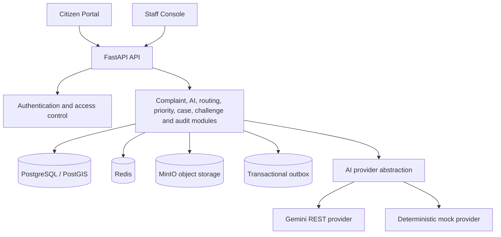

Smart Governance
AI-Assisted Municipal Grievance Intelligence and Accountability
Live frontend demo: https://smart-governance-woad.vercel.app/
API documentation (local): http://localhost:8000/docs
Core principle: AI recommends; accountable people decide.

Smart Governance is a municipal grievance management prototype designed to help citizens report local civic issues and help municipal teams triage, prioritise, route, coordinate, and review those reports. It combines a citizen-facing portal with a FastAPI backend, AI-assisted recommendations, case workflows, citizen challenges, and a tamper-evident audit trail.
Demo notice: The hosted website is a frontend demonstration. Demo-mode complaints use sample data and are not sent to a municipal authority. Do not enter real personal or sensitive information into the demo.

Contents
- Problem
- What the project includes
- Human oversight and accountability
- Architecture
- Technology stack
- Repository structure
- Run the application
- Configuration
- Demo accounts
- API overview
- Testing and code quality
- Current limitations
- Roadmap
- License
Problem
Municipal grievances can be difficult to manage when reports arrive in different formats, refer to the same incident, reach the wrong department, or have no clear owner. Citizens may also have limited visibility into what happened after submitting a complaint.
Smart Governance explores a more accountable workflow by combining structured complaint intake, decision support for staff, case ownership, public-facing updates, evidence-backed resolution proposals, and a way for citizens to challenge actions.
What the project includes
Citizen portal
- Submit a civic issue with a title, description, category, location, and optional photos.
- Enter or select a location using the map and coordinates.
- Use browser-supported speech recognition for voice-to-text input.
- Browse complaint details, tracking information, and activity timelines.
- Review a proposed resolution and challenge an action when the issue has not been addressed.
- Explore the interface in a clearly labelled demonstration mode using sample records.
Staff and administration workflows
- Role-based workflows for citizens, officers, department leads, supervisors, administrators, and auditors.
- AI-assisted complaint interpretation with structured fields, confidence, reported facts, and inferences.
- Department-routing and priority recommendations, with human accept, override, or reject decisions.
- Priority queue support for potentially safety-critical reports.
- Similar-incident suggestions using location, time, category, and semantic signals; staff can link or dismiss candidates rather than automatically merge them.
- Case grouping, participating departments, and a designated accountable lead department.
- Case activity entries that distinguish internal notes from citizen-visible updates.
- Resolution proposals with evidence and a citizen review/challenge workflow.
- Audit-event listing and hash-chain integrity verification.
- A manual-triage path when AI is unavailable or a recommendation cannot be safely used.
Feature availability differs between the interactive frontend demo and the backend API. The hosted demo should be treated as a product walkthrough, not a live municipal service.
Human oversight and accountability
The backend is designed around the following safeguards:
1. Recommendations are not decisions. Routing, priority, and interpretation output is presented for staff review.
2. Manual fallback. The code includes a manual-triage route for cases that need human assessment.
3. No automatic duplicate merging. Similarity results are candidates for human review.
4. Evidence-backed resolution. Case workflows support resolution proposals and verification/review steps.
5. Citizen recourse. Citizens can challenge eligible actions; reviewer logic is designed to prevent self-review.
6. Auditable changes. The backend records audit events and exposes an endpoint to verify the hash chain.
These are prototype safeguards and should be reviewed, tested, and operationally validated before deployment in a real municipal environment.
Architecture
The backend is organised as a modular monolith. API routers delegate business logic to service layers, with SQLAlchemy repositories and PostgreSQL persistence. Redis supports infrastructure features, MinIO is configured for object storage, and the AI layer supports a Gemini REST provider plus a deterministic mock provider.

Important runtime note: the repository contains outbox/worker code, but the current Docker Compose worker service is a placeholder process and does not run the ARQ worker. Background event processing and scheduled jobs therefore need to be wired up before relying on asynchronous workflows in a deployed environment.
Technology stack
Layer	Technologies
Frontend	React, TypeScript, Vite, TanStack Router, TanStack Query, Tailwind CSS, Leaflet
Backend API	Python 3.12, FastAPI, Pydantic v2, Uvicorn
Persistence	SQLAlchemy async, Alembic, PostgreSQL, PostGIS-capable Docker image
Infrastructure	Docker Compose, Redis, MinIO
Authentication	JWT access/refresh tokens, Argon2 password hashing, role-based access control
AI	Google Gemini REST API and deterministic MockProvider
Testing and quality	pytest, pytest-asyncio, httpx, Ruff, mypy, Vitest, ESLint

Repository structure
Smart_governance/
├── app/
│   ├── main.py                 # FastAPI app, middleware and API routers
│   ├── config.py               # Environment-based settings
│   ├── core/                   # Security, middleware, rate limiting, outbox and worker code
│   ├── db/                     # Database session, models base and seed data
│   └── modules/                # Feature modules (identity, complaints, AI, routing, etc.)
├── alembic/                    # Database migrations
├── docs/                       # Architecture, API endpoints, state machine and OpenAPI snapshot
├── frontend/                   # React/TypeScript web application
├── tests/                      # Unit and integration tests
├── Dockerfile
├── docker-compose.yml
├── Makefile
├── make.bat
├── pyproject.toml
├── requirements.txt
└── .env.example
Run the application
Prerequisites
- Docker Engine and Docker Compose
- Node.js and npm, if running the frontend locally
- Python 3.12 and pip, if running tests or backend tools directly on the host
- A Gemini API key only if you want to test the real Gemini provider; the backend falls back to MockProvider when no key is configured
1. Start the backend and its dependencies
From the repository root:
git clone https://github.com/veerbachpalle-jpg/Smart_governance.git
cd Smart_governance
docker compose up --build -d
Apply the database migrations and load the development seed data:
docker compose exec api alembic upgrade head
docker compose exec api python -m app.db.seed
Open the API documentation at http://localhost:8000/docs. Other useful endpoints are:
- GET http://localhost:8000/health — API liveness check
- GET http://localhost:8000/ready — database readiness check
View service logs with:
docker compose logs -f api
Stop the stack with:
docker compose down
The development database, Redis, and MinIO data are stored in Docker volumes. To remove those volumes as well, use docker compose down -v (this deletes local development data).
2. Run the frontend locally
In a second terminal:
cd frontend
npm install
cp .env.example .env.local
For a standalone walkthrough, set the following in frontend/.env.local:
VITE_USE_MOCKS=true
Then start the Vite development server:
npm run dev
Open the local URL printed by Vite, usually http://localhost:5173. In demo mode, the portal uses sample records and does not submit reports to a municipal authority.
The frontend also contains an API client and an Original Mode switch. The end-to-end frontend/backend contract is not complete for every action; verify the request fields and endpoint paths before using Original Mode as a connected service. The backend API can be explored independently through /docs.
3. Run backend commands directly (optional)
Create and activate a Python 3.12 virtual environment, then install dependencies:
python -m venv .venv
# Linux/macOS:
source .venv/bin/activate
# Windows PowerShell:
# .\.venv\Scripts\Activate.ps1
pip install -r requirements.txt
For host-based backend development, ensure PostgreSQL, Redis, and MinIO are running and that the .env settings point to those services. Then run:
alembic upgrade head
python -m app.db.seed
uvicorn app.main:app --reload --host 0.0.0.0 --port 8000
Configuration
The root .env.example documents the main local settings. Important backend settings include:
Variable	Purpose
DATABASE_URL	Async SQLAlchemy database connection string
REDIS_URL	Redis connection string
MINIO_ENDPOINT	MinIO endpoint used for attachments
MINIO_ROOT_USER, MINIO_ROOT_PASSWORD	MinIO development credentials
JWT_SECRET_KEY	JWT signing secret; replace the development value before deployment
ACCESS_TOKEN_EXPIRE_MINUTES, REFRESH_TOKEN_EXPIRE_DAYS	Token lifetimes
AI_ENABLED	Enables or disables AI-assisted processing
GEMINI_API_KEY	Optional key for the real Gemini provider; omit it to use the mock provider
GEMINI_MODEL, GEMINI_EMBEDDING_MODEL	Gemini model names used by the provider
AI_CONFIDENCE_THRESHOLD, AI_TIMEOUT_SECONDS	AI confidence and timeout configuration
CORS_ORIGINS	Comma-separated allowed frontend origins
RATE_LIMIT_ENABLED	Enables Redis-backed rate limiting
MAX_UPLOAD_SIZE_MB	Upload size limit

The current Compose file uses development-oriented settings and credentials in its service definitions. Do not deploy it unchanged to production. Configure secrets, CORS, storage, database access, and the background worker for the target environment.
Demo accounts
Running the seed command creates development accounts. These credentials are for local development only:
Role	Email	Password
Citizen	citizen@example.com	CitizenDemo123!
Officer	officer@example.com	OfficerDemo123!
Department lead	lead@example.com	LeadDemo123!
Supervisor	supervisor@example.com	SupervisorDemo123!
Administrator	admin@example.com	AdminDemo123!
Auditor	auditor@example.com	AuditorDemo123!

Do not reuse these credentials or retain seeded accounts in a production environment. The hosted frontend demo uses its own sample mode; these backend accounts are not required to explore it.
API overview
The API is versioned under /api/v1. Interactive documentation and request schemas are available at /docs when the backend is running. A checked-in OpenAPI snapshot is available at [`docs/openapi.json`](docs/openapi.json).
Area	Example endpoints	Purpose
Authentication	POST /api/v1/auth/register, POST /api/v1/auth/login	Citizen registration and token issuance
Complaints	POST /api/v1/complaints, GET /api/v1/complaints/{complaint_id}	Submit and retrieve complaints
AI interpretation	GET /api/v1/complaints/{complaint_id}/ai-interpretation	View a structured triage recommendation
Routing	GET /api/v1/complaints/{complaint_id}/routing	Inspect department suggestions
Priority	GET /api/v1/complaints/{complaint_id}/priority, GET /api/v1/priority/queue	Review priority assessments and safety queue
Similar incidents	GET /api/v1/complaints/{complaint_id}/duplicates	Retrieve duplicate candidates for staff review
Cases	POST /api/v1/cases, POST /api/v1/cases/{case_id}/transition	Group complaints and manage case state
Challenges	POST /api/v1/cases/{case_id}/challenge, POST /api/v1/challenges/{challenge_id}/review	Submit and review challenges
Audit	GET /api/v1/audit/events, GET /api/v1/audit/verify	Query audit history and verify the hash chain
Manual triage	GET /api/v1/triage/manual/queue	Find complaints awaiting human triage

Creating complaint requests require an Idempotency-Key header. Authentication and role permissions apply to protected endpoints; consult the live API documentation for exact schemas and requirements.
Testing and code quality
Install the Python dependencies before running the backend suite:
pip install -r requirements.txt
python -m pytest -q
Additional backend checks:
ruff check .
ruff format --check .
mypy app
Frontend checks (from frontend/):
npm test
npm run lint
npm run build
Tests should be run in the target development environment before submitting changes. The repository contains unit and integration tests; test results are not represented as passing unless the commands have been run successfully.
Current limitations
- The hosted frontend is a demonstration with sample data, not a live government service.
- Some frontend actions are still mock-only or await full API-contract integration. The backend and frontend should be tested together before presenting Original Mode as a complete end-to-end deployment.
- The Docker Compose worker is currently a placeholder. Configure and run the ARQ worker and schedule its polling jobs before depending on background outbox processing or automated review-window/SLA jobs.
- Notification delivery and real municipal channels (such as official SMS, email, or government systems) require deployment-specific integration.
- Seed credentials, JWT defaults, and Compose service passwords are for local development only.
- No official municipal boundaries, municipal integrations, or production service-level commitments are configured in this repository.
Roadmap
- Complete and test the frontend/backend API integration across all user workflows.
- Wire up the ARQ worker, polling schedule, retries, and scheduled review/SLA tasks in the deployment configuration.
- Add production secret management, deployment profiles, monitoring, and operational alerting.
- Integrate official municipal ward boundaries and department data.
- Add real notification channels and measure AI recommendation quality on appropriately governed, anonymised datasets.
- Conduct security, privacy, accessibility, and workflow testing with municipal stakeholders before any real-world rollout.
