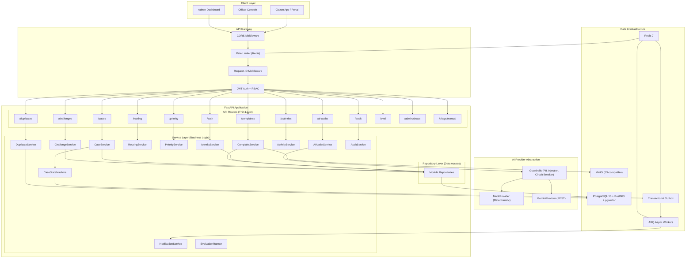
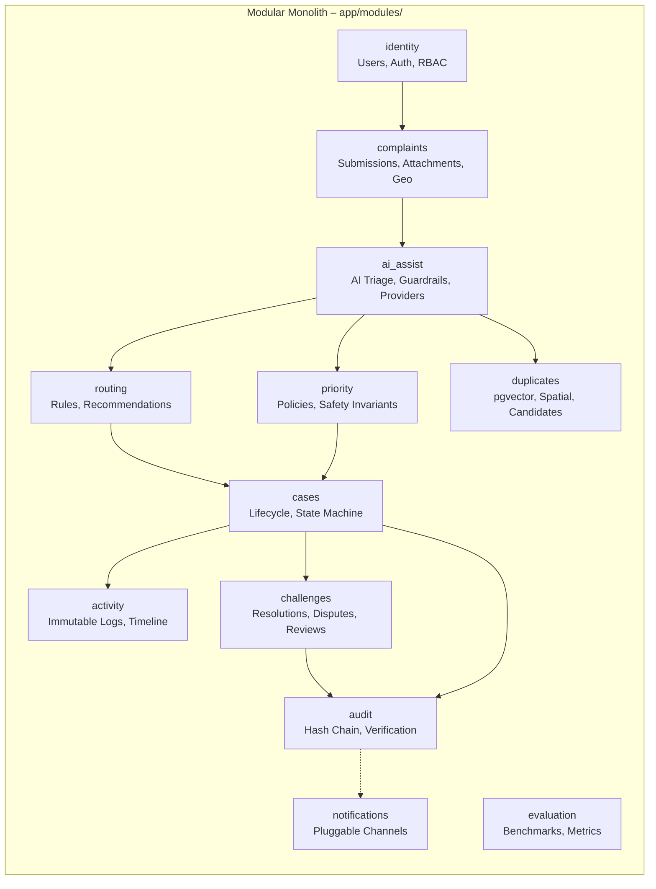
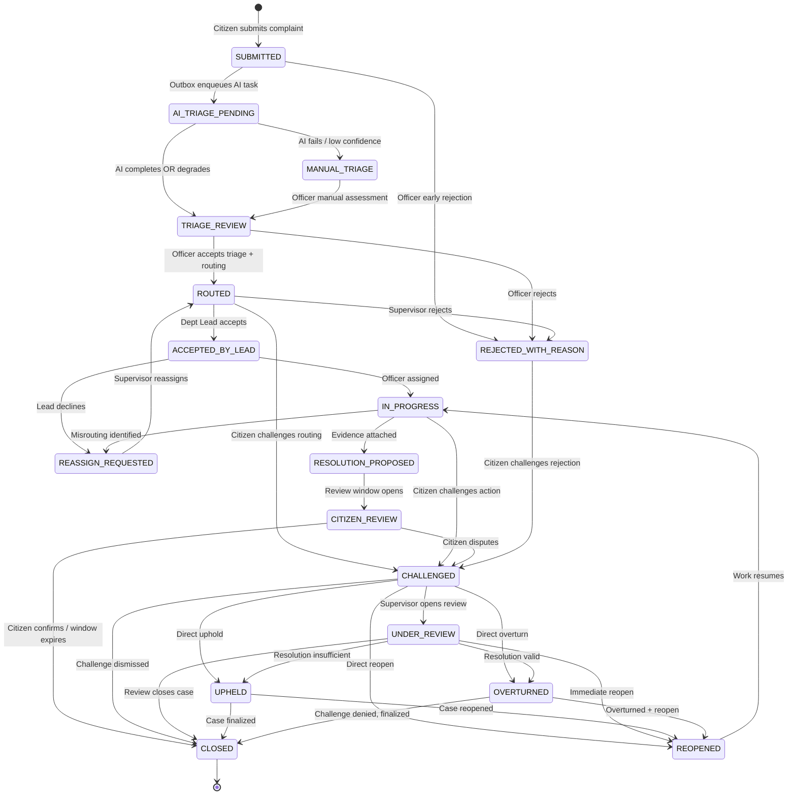
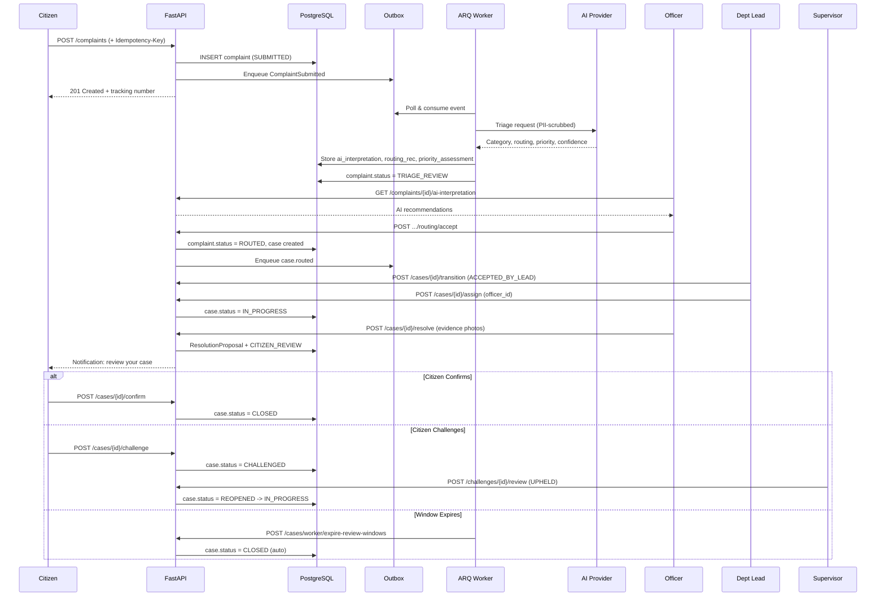

# System Architecture

## Overview

The Municipal Grievance Intelligence & Accountability System is a **modular monolith** built with Python 3.12, FastAPI, SQLAlchemy 2 (async), and PostgreSQL. It augments human decision-makers with AI-powered triage while enforcing strict evidence-based accountability through an immutable audit trail.

---

## High-Level Architecture Diagram

---

## Module Decomposition

---

## Case State Machine

---

## Data Flow: Complaint-to-Resolution Pipeline

---

## Security Architecture

| Layer | Mechanism | Details |
|:---|:---|:---|
| **Transport** | TLS termination | Reverse proxy (nginx/traefik) in production |
| **Authentication** | Stateless JWT | Access (30min) + Refresh (7day), Argon2id password hashing |
| **Authorization** | RBAC middleware | `require_roles()` dependency on every route; 6 roles |
| **Object-Level AuthZ** | Service-layer checks | Citizens see only own complaints; officers see department scope |
| **Rate Limiting** | Redis sliding window | Tiered limits per endpoint class, graceful degradation |
| **CORS** | Allowlist-based | Configurable origins; no wildcard in production |
| **Input Validation** | Pydantic v2 strict | Type coercion disabled; RFC 7807 error responses |
| **Upload Security** | Magic-byte inspection | MIME whitelist, 15MB cap, executable rejection |
| **PII Protection** | Regex redaction | Phone, email, Aadhaar scrubbed before AI egress |
| **Prompt Injection** | XML boundary wrapping | Untrusted input wrapped in `<untrusted_citizen_submission>` tags |
| **Audit Integrity** | SHA-256 hash chain | Append-only with cryptographic tamper detection |
| **Idempotency** | Request hash dedup | SHA-256 body hash with 24h TTL; replay or 409 conflict |
| **Chaos Safety** | Environment guard | Chaos endpoints rejected with 403 in production |

---

## Infrastructure Dependencies

| Component | Version | Purpose |
|:---|:---|:---|
| Python | 3.12+ | Runtime |
| FastAPI | 0.110+ | Web framework |
| PostgreSQL | 16+ | Primary datastore |
| PostGIS | 3.4+ | Geospatial queries (ward lookup, nearby complaints) |
| pgvector | 0.7+ | Embedding similarity search (duplicate detection) |
| Redis | 7+ | Rate limiting, idempotency cache, ARQ job queue |
| MinIO | Latest | S3-compatible object storage for attachments |
| Alembic | 1.13+ | Database migrations |
| ARQ | 0.25+ | Async background workers |
