# Municipal Grievance System - Entity-Relationship Diagram

## 1. Architecture & Entity Overview

This ER diagram covers all 26 core domain entities required for the AI-Powered Municipal Grievance Intelligence and Accountability System.

### Critical Database Invariants & Constraints:
1. **Single Accountable Lead Department**:
   ```sql
   CREATE UNIQUE INDEX uq_case_lead_dept ON case_departments (case_id) WHERE is_lead = TRUE;
   ```
2. **PostGIS Spatial Indexing**:
   ```sql
   CREATE INDEX idx_complaints_geom ON complaints USING GIST (location_point);
   ```
3. **pgvector Embedding Indexing**:
   ```sql
   CREATE INDEX idx_complaints_embedding ON complaints USING hnsw (text_embedding vector_cosine_ops);
   ```
4. **Outbox Polling Index**:
   ```sql
   CREATE INDEX idx_outbox_pending ON outbox_events (created_at) WHERE status = 'PENDING';
   ```

---

## 2. Mermaid Entity-Relationship Diagram

```mermaid
erDiagram
    users ||--o| citizen_profiles : "has"
    users ||--o{ department_members : "belongs_to"
    departments ||--o{ department_members : "employs"
    departments ||--o{ routing_rules : "owns"
    users ||--o{ complaints : "submits"
    complaints ||--o{ attachments : "has"
    complaints ||--o{ ai_interpretations : "evaluated_by"
    complaints ||--o{ routing_recommendations : "routed_by"
    complaints ||--o{ priority_assessments : "prioritized_by"
    complaints ||--o{ duplicate_suggestions : "source_of"
    complaints ||--o{ duplicate_suggestions : "candidate_target"
    complaints ||--o| cases : "originates"
    cases ||--o{ case_departments : "allocated_to"
    departments ||--o{ case_departments : "handles"
    cases ||--o{ case_activities : "records"
    cases ||--o{ citizen_updates : "receives"
    cases ||--o{ resolution_proposals : "resolves_through"
    resolution_proposals ||--o{ attachments : "verified_with"
    resolution_proposals ||--o| citizen_challenges : "challenged_by"
    citizen_challenges ||--o| challenge_reviews : "reviewed_by"
    cases ||--o{ reopen_events : "reopened_by"
    eval_datasets ||--o{ eval_runs : "tested_in"
    eval_runs ||--o{ eval_results : "measures"
    outbox_events ||--o| dead_letter_events : "overflows_to"

    users {
        uuid id PK
        varchar email UK
        varchar phone_number UK
        varchar password_hash
        varchar role
        boolean is_active
        timestamptz created_at
        timestamptz updated_at
    }

    citizen_profiles {
        uuid id PK
        uuid user_id FK,UK
        varchar full_name
        text address
        varchar preferred_language
        varchar notification_preference
        timestamptz created_at
        timestamptz updated_at
    }

    departments {
        uuid id PK
        varchar code UK
        varchar name
        text description
        boolean is_active
        timestamptz created_at
    }

    department_members {
        uuid id PK
        uuid department_id FK
        uuid user_id FK
        varchar member_role
        boolean is_active
        timestamptz joined_at
    }

    routing_rules {
        uuid id PK
        uuid department_id FK
        integer rule_version
        varchar category_pattern
        geometry ward_boundary
        jsonb conditions
        boolean is_active
        uuid created_by FK
        timestamptz created_at
    }

    priority_policies {
        uuid id PK
        varchar policy_name
        integer version
        jsonb criteria
        integer default_sla_hours
        boolean is_active
        timestamptz created_at
    }

    complaints {
        uuid id PK
        varchar tracking_number UK
        uuid citizen_id FK
        varchar raw_title
        text raw_description
        geometry location_point
        text address_text
        varchar ward_id
        varchar status
        vector text_embedding
        timestamptz submitted_at
        timestamptz updated_at
    }

    attachments {
        uuid id PK
        uuid complaint_id FK
        uuid resolution_proposal_id FK
        uuid challenge_id FK
        uuid uploader_id FK
        varchar file_url
        varchar mime_type
        bigint file_size_bytes
        varchar sha256_hash
        varchar attachment_type
        timestamptz created_at
    }

    ai_interpretations {
        uuid id PK
        uuid complaint_id FK
        varchar model_provider
        varchar model_version
        varchar extracted_category
        jsonb extracted_urgency_factors
        text summary
        numeric confidence_score
        jsonb raw_response
        varchar status
        uuid decided_by FK
        timestamptz decided_at
        timestamptz created_at
    }

    routing_recommendations {
        uuid id PK
        uuid complaint_id FK
        uuid recommended_department_id FK
        numeric confidence_score
        text reasoning
        uuid rule_matched_id FK
        varchar status
        uuid decided_by FK
        uuid override_department_id FK
        text override_reason
        timestamptz decided_at
        timestamptz created_at
    }

    priority_assessments {
        uuid id PK
        uuid complaint_id FK
        varchar recommended_priority
        numeric confidence_score
        jsonb factors_identified
        varchar status
        uuid decided_by FK
        varchar decided_priority
        text override_reason
        timestamptz decided_at
        timestamptz created_at
    }

    duplicate_suggestions {
        uuid id PK
        uuid source_complaint_id FK
        uuid target_complaint_id FK
        numeric similarity_score
        numeric distance_meters
        numeric time_delta_hours
        varchar status
        uuid decided_by FK
        timestamptz decided_at
        timestamptz created_at
    }

    cases {
        uuid id PK
        varchar case_number UK
        uuid complaint_id FK,UK
        varchar current_status
        varchar final_priority
        timestamptz sla_deadline
        timestamptz resolution_deadline
        boolean is_reopened
        timestamptz created_at
        timestamptz updated_at
    }

    case_departments {
        uuid id PK
        uuid case_id FK
        uuid department_id FK
        boolean is_lead
        uuid assigned_officer_id FK
        timestamptz assigned_at
    }

    case_activities {
        uuid id PK
        uuid case_id FK
        uuid actor_id FK
        varchar activity_type
        varchar visibility
        text message
        jsonb metadata
        timestamptz created_at
    }

    citizen_updates {
        uuid id PK
        uuid case_id FK
        uuid citizen_id FK
        text message
        jsonb additional_info
        timestamptz created_at
    }

    resolution_proposals {
        uuid id PK
        uuid case_id FK
        uuid proposing_officer_id FK
        text remediation_summary
        text root_cause_identified
        boolean officer_verified
        timestamptz officer_verified_at
        timestamptz review_window_expires_at
        varchar status
        timestamptz created_at
    }

    citizen_challenges {
        uuid id PK
        uuid resolution_proposal_id FK,UK
        uuid case_id FK
        uuid citizen_id FK
        text reason
        varchar status
        timestamptz created_at
    }

    challenge_reviews {
        uuid id PK
        uuid challenge_id FK,UK
        uuid reviewer_id FK
        varchar verdict
        text rationale
        text action_taken
        timestamptz reviewed_at
    }

    reopen_events {
        uuid id PK
        uuid case_id FK
        varchar trigger_source
        uuid challenge_id FK
        uuid authorized_by FK
        text reason
        timestamptz reopened_at
    }

    audit_events {
        uuid id PK
        varchar entity_type
        uuid entity_id
        varchar action
        uuid actor_id FK
        varchar actor_role
        varchar ip_address
        varchar user_agent
        jsonb old_state
        jsonb new_state
        timestamptz occurred_at
    }

    outbox_events {
        uuid id PK
        varchar event_type
        varchar aggregate_type
        uuid aggregate_id
        jsonb payload
        varchar status
        integer retry_count
        timestamptz next_retry_at
        timestamptz created_at
        timestamptz processed_at
    }

    dead_letter_events {
        uuid id PK
        uuid outbox_event_id FK
        varchar event_type
        jsonb payload
        text failure_reason
        text stack_trace
        timestamptz failed_at
    }

    eval_datasets {
        uuid id PK
        varchar dataset_name
        varchar version
        text description
        integer sample_count
        uuid created_by FK
        timestamptz created_at
    }

    eval_runs {
        uuid id PK
        uuid dataset_id FK
        varchar model_identifier
        varchar task_type
        varchar status
        uuid run_by FK
        timestamptz started_at
        timestamptz completed_at
    }

    eval_results {
        uuid id PK
        uuid run_id FK
        varchar metric_name
        numeric metric_value
        jsonb confusion_matrix
        jsonb raw_metrics
        timestamptz evaluated_at
    }
```


