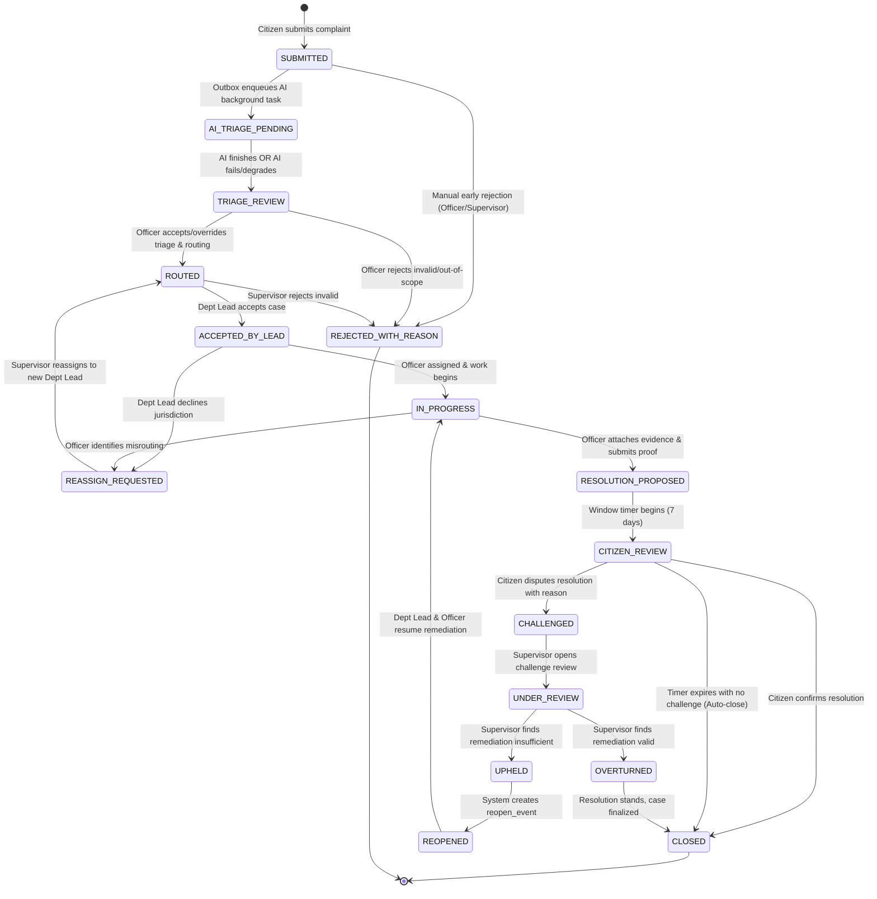

# Case State Machine & Lifecycle Specification

## 1. State Machine Overview

The Municipal Grievance Accountability System enforces a deterministic, human-governed state machine. 

### Critical Invariants:
1. **Human Decisiveness**: AI produces non-binding recommendations (`PENDING`). Transition from triage to routing requires explicit officer/lead acceptance or override.
2. **Resolution Evidence Requirement**: Transition to `RESOLUTION_PROPOSED` is rejected at API and service levels unless at least one valid remediation proof attachment (photo/document) is linked AND the proposing officer has checked verification (`officer_verified = true`).
3. **Closure Invariants**: A case reaches `CLOSED` **only** if:
   - Remediation evidence was verified by an officer, **AND**
   - Either the citizen explicitly confirms satisfaction, **OR** the 7-day citizen review window elapses without challenge, **OR** a challenge is formally `OVERTURNED` after supervisor review.
4. **Audit & Activity Immutability**: Every transition atomically writes an entry to `audit_events` and an entry to `case_activities` (with designated `visibility`), and queues an event in `outbox_events`.

---

## 2. Mermaid State Transition Diagram



---

## 3. State Transition Matrix

| From State | To State | Trigger / Event | Allowed Roles | Required Inputs & Invariants | Emitted Activity & Visibility |
| :--- | :--- | :--- | :--- | :--- | :--- |
| `[*] ` | `SUBMITTED` | `complaint.submit` | `citizen` | Title, description, GPS coordinates/address, optional photos. | `COMPLAINT_SUBMITTED` (CITIZEN_VISIBLE) |
| `SUBMITTED` | `AI_TRIAGE_PENDING` | `ai.triage.enqueue` | `system` (worker) | Complaint persisted. Outbox triggers ARQ worker. | `AI_TRIAGE_STARTED` (INTERNAL) |
| `SUBMITTED` | `REJECTED_WITH_REASON` | `complaint.reject` | `officer`, `supervisor` | Rejection category + mandatory explanation text. | `COMPLAINT_REJECTED` (CITIZEN_VISIBLE) |
| `AI_TRIAGE_PENDING` | `TRIAGE_REVIEW` | `ai.triage.complete` | `system` (worker) | AI results stored (`ai_interpretations`, `routing_recommendations`, `priority_assessments`) OR fallback flag if failed. | `AI_TRIAGE_COMPLETED` (INTERNAL) |
| `TRIAGE_REVIEW` | `ROUTED` | `triage.decide` | `officer`, `supervisor` | Target department ID chosen. AI rec status set to `ACCEPTED` or `OVERRIDDEN` with `decided_by`. Initial case created. | `CASE_ROUTED` (CITIZEN_VISIBLE) |
| `TRIAGE_REVIEW` | `REJECTED_WITH_REASON` | `triage.reject` | `officer`, `supervisor` | Rejection category + mandatory explanation text. | `COMPLAINT_REJECTED` (CITIZEN_VISIBLE) |
| `ROUTED` | `ACCEPTED_BY_LEAD` | `case.accept_lead` | `department_lead` | Department lead verifies jurisdiction. `case_departments.is_lead` set to `TRUE`. | `CASE_ACCEPTED_BY_DEPARTMENT` (CITIZEN_VISIBLE) |
| `ROUTED` | `REJECTED_WITH_REASON` | `case.reject` | `supervisor` | Mandatory justification note. | `CASE_REJECTED` (CITIZEN_VISIBLE) |
| `ACCEPTED_BY_LEAD` | `IN_PROGRESS` | `case.assign_officer` | `department_lead` | Assigned officer user ID. Case status updated. | `OFFICER_ASSIGNED` (CITIZEN_VISIBLE) |
| `ACCEPTED_BY_LEAD` | `REASSIGN_REQUESTED` | `case.request_reassign` | `department_lead` | Reassignment justification note detailing why department is not accountable. | `REASSIGNMENT_REQUESTED` (INTERNAL) |
| `IN_PROGRESS` | `REASSIGN_REQUESTED` | `case.request_reassign` | `department_lead`, `officer` | Justification note from field assessment. | `REASSIGNMENT_REQUESTED` (INTERNAL) |
| `REASSIGN_REQUESTED` | `ROUTED` | `case.reassign` | `supervisor` | New lead department specified. `case_departments` lead updated. | `CASE_REASSIGNED` (CITIZEN_VISIBLE) |
| `IN_PROGRESS` | `RESOLUTION_PROPOSED` | `resolution.propose` | `officer`, `department_lead` | **INVARIANT**: At least 1 valid attachment (resolution proof photo) + remediation summary + `officer_verified = true`. | `RESOLUTION_PROPOSED` (CITIZEN_VISIBLE) |
| `RESOLUTION_PROPOSED` | `CITIZEN_REVIEW` | `resolution.publish` | `system` | Proposal verified. 7-day review timer initialized (`review_window_expires_at = now() + 7 days`). | `CITIZEN_REVIEW_OPENED` (CITIZEN_VISIBLE) |
| `CITIZEN_REVIEW` | `CLOSED` | `citizen.confirm` | `citizen` | Citizen explicitly confirms resolution satisfaction via UI/API. | `CASE_CLOSED_BY_CITIZEN` (CITIZEN_VISIBLE) |
| `CITIZEN_REVIEW` | `CLOSED` | `case.auto_close` | `system` (worker) | `review_window_expires_at` reached with no challenge registered. | `CASE_AUTO_CLOSED` (CITIZEN_VISIBLE) |
| `CITIZEN_REVIEW` | `CHALLENGED` | `citizen.challenge` | `citizen` | Mandatory challenge reason text + optional counter-evidence photo. Must be within review window. | `RESOLUTION_CHALLENGED` (CITIZEN_VISIBLE) |
| `CHALLENGED` | `UNDER_REVIEW` | `challenge.open_review` | `supervisor` | Supervisor assigns self to review citizen dispute. | `CHALLENGE_UNDER_REVIEW` (INTERNAL) |
| `UNDER_REVIEW` | `UPHELD` | `challenge.uphold` | `supervisor` | Rationale explaining why resolution was defective/incomplete. | `CHALLENGE_UPHELD` (CITIZEN_VISIBLE) |
| `UNDER_REVIEW` | `OVERTURNED` | `challenge.overturn` | `supervisor` | Detailed rationale validating municipal remediation evidence. | `CHALLENGE_OVERTURNED` (CITIZEN_VISIBLE) |
| `UPHELD` | `REOPENED` | `case.reopen` | `system` (atomic with uphold) | `reopen_events` record logged with `trigger_source = 'CHALLENGE_UPHELD'`. | `CASE_REOPENED` (CITIZEN_VISIBLE) |
| `REOPENED` | `IN_PROGRESS` | `case.resume_work` | `department_lead`, `supervisor` | Remediation instructions updated. Lead department renotified. | `WORK_RESUMED` (CITIZEN_VISIBLE) |
| `OVERTURNED` | `CLOSED` | `case.finalize_closure` | `system` (atomic with overturn) | Challenge officially dismissed. Case permanently closed. | `CASE_CLOSED_SUPERVISOR_UPHELD` (CITIZEN_VISIBLE) |

---

## 4. Universal Side-Effect Contract

For every execution of a transition in the matrix above, the service layer MUST execute the following within a single PostgreSQL transaction:
```python
async with session.begin():
    # 1. Mutate Complaint / Case state
    await case_repo.update_status(case_id, next_state)

    # 2. Append immutable Audit Event
    await audit_repo.record_event(
        entity_type="case",
        entity_id=case_id,
        action=transition_action,
        actor_id=current_user.id,
        actor_role=current_user.role,
        old_state={"status": current_state},
        new_state={"status": next_state},
        ip_address=request_ip,
        user_agent=request_user_agent,
    )

    # 3. Append immutable Case Activity
    await activity_repo.record_activity(
        case_id=case_id,
        actor_id=current_user.id,
        activity_type=activity_type,
        visibility=visibility,
        message=activity_message,
        metadata=activity_metadata,
    )

    # 4. Insert Transactional Outbox Event for async notifications & ARQ triggers
    await outbox_repo.enqueue_event(
        event_type=f"case.{next_state.lower()}",
        aggregate_type="case",
        aggregate_id=case_id,
        payload=event_payload,
    )
```
